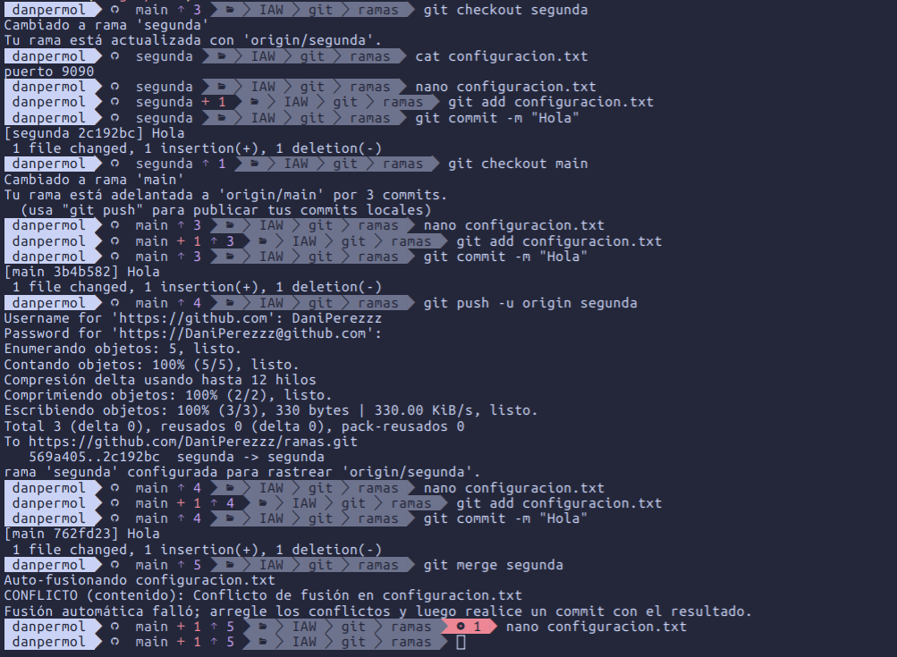
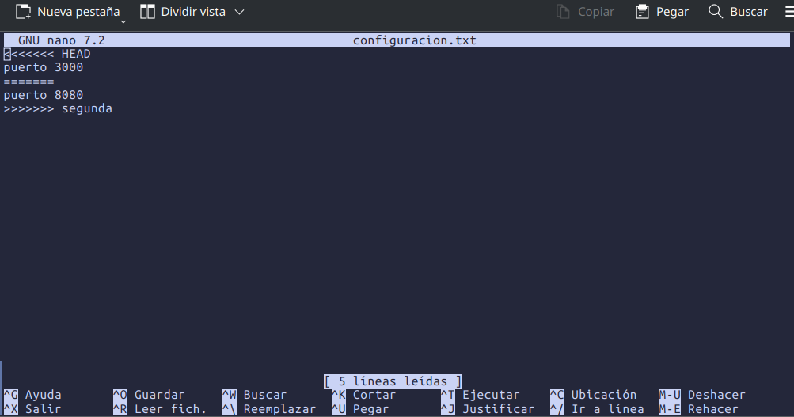
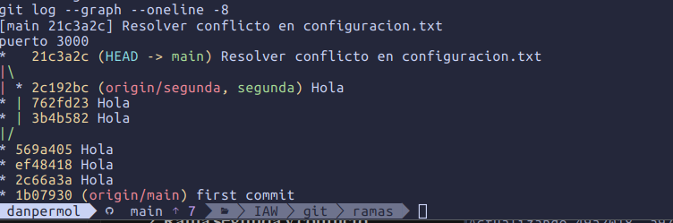
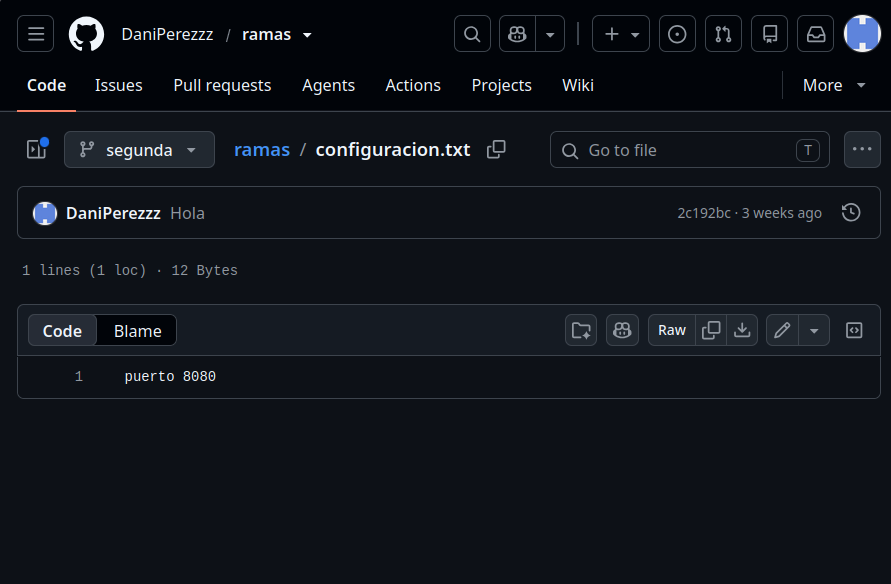
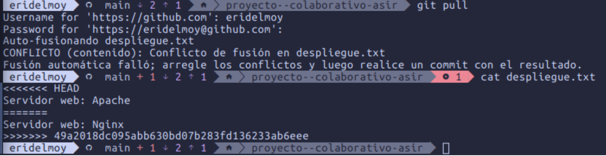
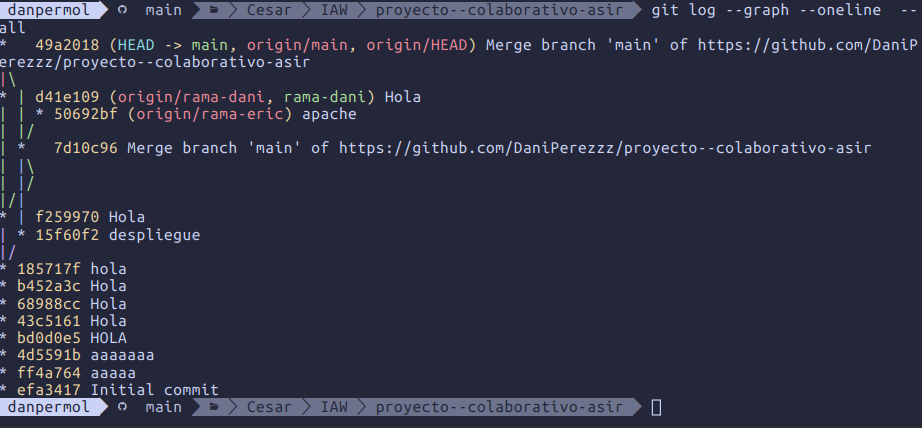
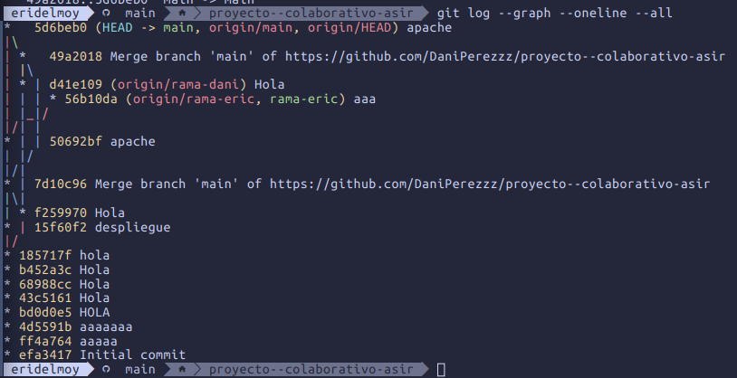
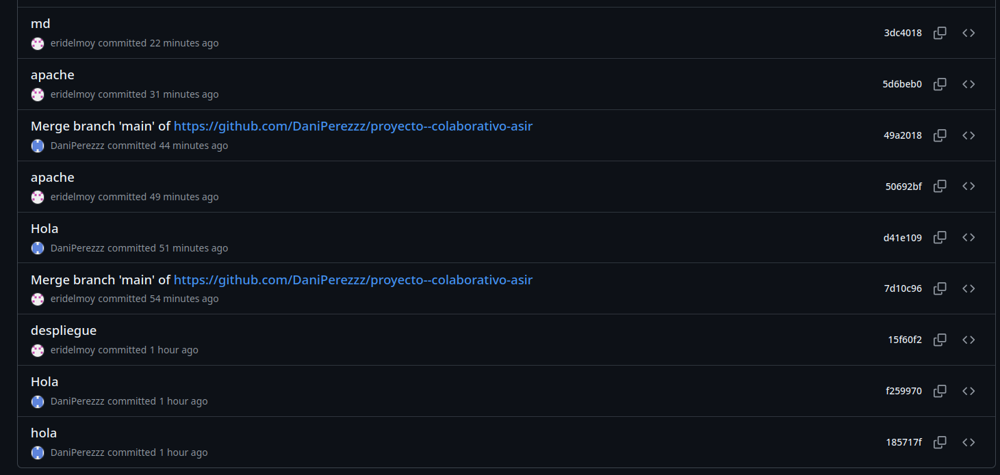

# Tarea 2 Git - Ramas y conflictos

## Parte 1

### 1. Fusión de la rama primera

Creé la rama primera, hice el fichero funcionalidad.txt, le hice commit y luego volví a main e hice el merge. Después borré la rama con `git branch -d primera`.

La fusión fue Fast-forward. Esto pasa porque en main no había ningún commit nuevo desde que creé la rama primera, así que Git solo tuvo que mover main hasta el último commit de primera sin crear un commit de merge. Tampoco hubo conflicto porque solo se habían hecho cambios en una de las dos ramas, no había nada que chocara.

### 2. Rama segunda y conflicto

Cambié el puerto en configuracion.txt en la rama segunda, hice commit y la subí con `git push -u origin segunda`. Luego en main cambié la misma línea con otro puerto, hice commit e intenté hacer `git merge segunda`, y me salió el conflicto.

Al abrir el fichero con nano salen las marcas del conflicto. Lo que hay entre `<<<<<<< HEAD` y `=======` es lo que tengo en main, y lo que hay entre `=======` y `>>>>>>> segunda` es lo que viene de la rama segunda.

Para arreglarlo borré las marcas y dejé solo `puerto 3000`, y después hice `git add configuracion.txt` y `git commit` para terminar el merge.

### 3. Rama en GitHub

Aquí se ve la rama segunda subida al repositorio:

## Parte 2

### 1. Conflicto en pareja

Yo subí primero mi rama con Nginx a main y cuando mi compañero Eric hizo el `git pull` con su rama de Apache le salió el conflicto en despliegue.txt. En HEAD está lo suyo (Apache) y abajo lo que venía del remoto (Nginx).

Lo hablamos y al final decidimos quedarnos con Apache, así que Eric borró las marcas, dejó esa línea, hizo el commit del merge y lo subió a main.

### 2. Historial

Este es el `git log --graph --oneline --all` desde mi equipo:

Y este desde el de Eric, donde ya se ve el commit final con el conflicto resuelto:

Y en GitHub se ven los commits de los dos con su autor y cuándo se hicieron:

